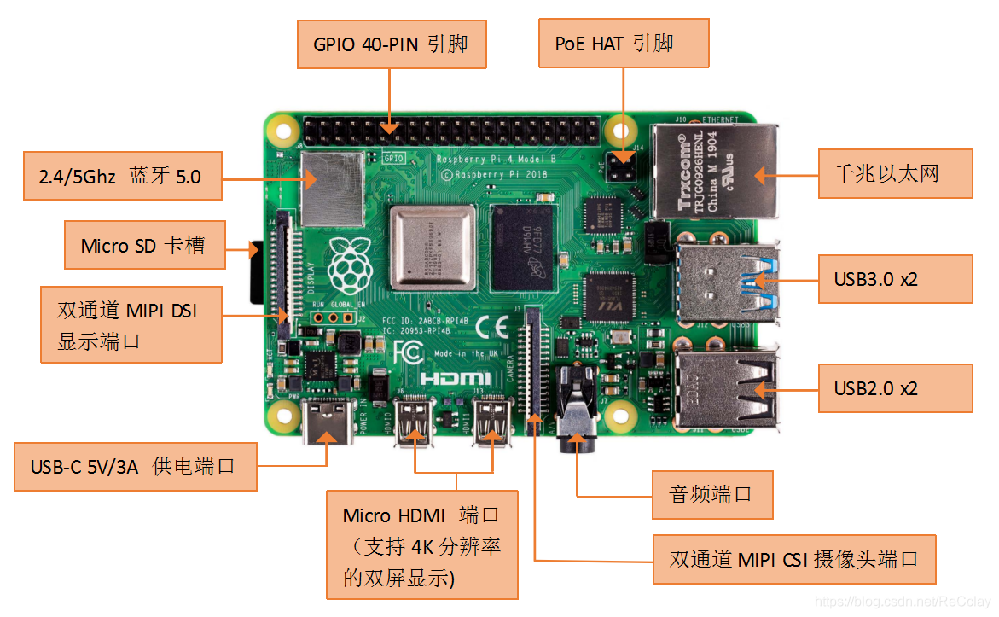
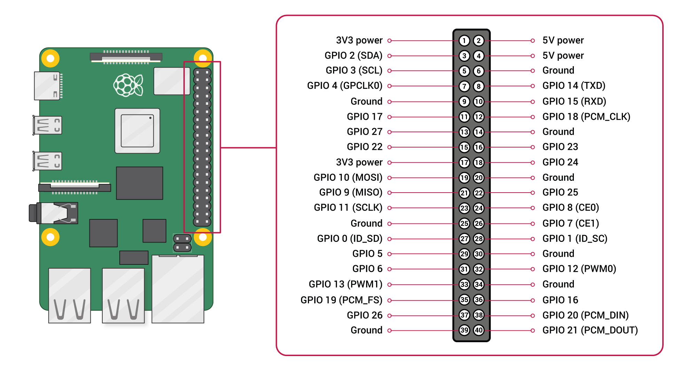

# 【Board name】Raspberry Pi 4b

****

**Version feature**

- Adaptive GPU

**build a development environment**

**1、Install dependent tools**

Installation command:

```
apt update&&apt-get install -y git git-lfs curl python3 python3-pip default-jdk device-tree-compiler cpio bison ccache ruby flex libtinfo5 xorg-dev libssl-dev bc dosfstools mtools
```

**explain：** 
The preceding installation commands apply to Ubuntu20.04 docker.

**2、Get the standard system source code**

**precondition**

1）Register git account and configure user information
```
git config --global user.name "yourname"

git config --global user.email "your-email-address"
```

2）Install the repo

```
curl https://gitee.com/oschina/repo/raw/fork_flow/repo-py3 | sudo tee /usr/local/bin/repo >/dev/null &&sudo chmod a+x /usr/local/bin/repo &&sudo ln -sf bash /bin/sh
```

**Get the source code**

Download via repo + https.

```
repo init -u https://gitee.com/openharmony-sig/manifest.git -b master -m devboard_rpi4b.xml --no-repo-verify 

repo sync -c

repo forall -c 'git lfs pull'
```

**Execute prebuilts**

Execute scripts in the source root directory, install the compiler and binary tools.

```
./build/prebuilts_download.sh
```


**Compile and burn**

**1、Compile**

Go to the root directory of the source code and execute the following command to compile the version.
Enter first:
```
./build.sh --product-name rpi4 --ccache
```
When finished, enter:
```
./build.sh --product-name rpi4 --ccache --build-target rpi_image
```


The files generated by the compilation are archived in the out/rpi4/ directory,
and the resulting image output is in out/rpi4/packages/phone/images/


**2、Burning tool**

Burning requires at least 16GB TF card and a card reader.

After using SDCardFormatter formatting TF card, use Win32DiskImager burning out/rpi4 / packages/phone/images/directory rpi_image. Img file.

[SDCardFormatter](https://www.sdcardformatter.com/download/)

[Win32DiskImager](https://win32diskimager.org/#download)

**debug**

**1、Connect the serial port**

The serial pin is shown as follows:
****
1、Connect pins 6, 8, and 10.
2、Open Xshell, create a new session, and select SERIAL in the connected protocol.
3、Go to the serial port TAB, select the correct port number, baud rate 115200, and then connect.


**3、HDC**

To use the HDC tool (command) :
```

hdc connection:
Connect a network cable to obtain the ip address of the hdc tconn device. Enter: 
    hdc tconn {ip address of the device}: 5555
in the CLI of the PC. If the output is Connect OK, the connection is successful.

Other commands:
(1)hdc shell:Enter the command line
(2)hdc file send {Local system file path} {oh system file path}: send the file
(3)hdc file recv {oh system file path} {local system file path}: receives the file
(4)hdc install XXX.hap:Installing the hap package
```

**contact**

[Dy](https://gitee.com/d1124)
[Diemit](https://gitee.com/diemit)


